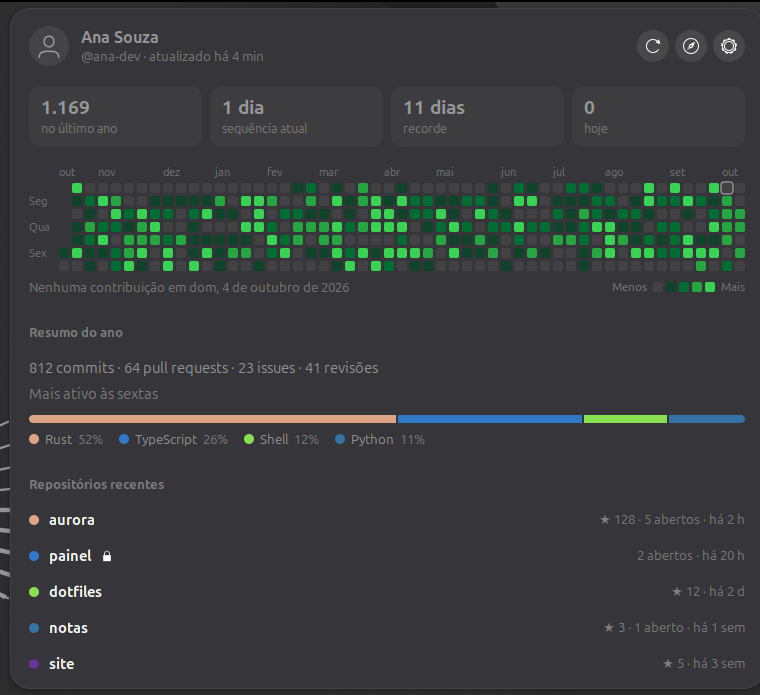
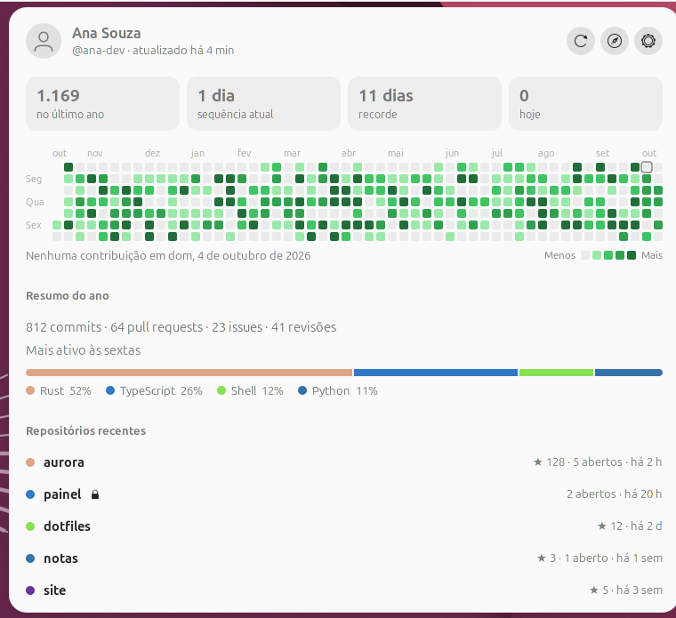

# GitHub Pulse

**English** | [Português](README.pt-BR.md)

**Your GitHub activity in the GNOME top bar.**

The top bar shows your last 7 days as small squares, like GitHub's
contribution graph. Click it to see the yearly grid, your streaks, a summary
of the year and your most recently pushed repositories.



| Light style | In the top bar |
|---|---|
|  |  |

*Screenshots taken with a demo account.*

| | |
|---|---|
| **GNOME Shell** | 50 |
| **Version** | 0.1.0, see the [CHANGELOG](CHANGELOG.md) (in Portuguese) |
| **License** | GPL-3.0-or-later |
| **Interface language** | Brazilian Portuguese (translations are planned) |

## What it shows

- **In the top bar:** the last 7 days, oldest on the left and today on the
  right, in GitHub's shades of green.
- **In the menu:**
  - **header:** your picture, your name, when the data was last updated, and
    three buttons: refresh, open your GitHub profile, and settings;
  - **four numbers:** contributions in the last year, current streak,
    longest streak and today's contributions;
  - **yearly grid:** one column per week (Sunday on top), month names on top
    and a "Less … More" legend. Hover over a day to see its date and count;
  - **year summary:** commits, pull requests, issues and reviews; the day of
    the week you contribute the most; and the languages of the repositories
    you committed to;
  - **recent repositories:** the ones you pushed to most recently, with the
    language colour, a lock if they are private, stars, open issues and pull
    requests, and the time of the last push. Click one to open it in your
    browser.
- **Offline:** it keeps showing the last saved data and tells you why it
  could not refresh.
- **Light and dark styles:** the colours follow the GNOME style.

## Installation

```bash
git clone https://github.com/joaocarvalhosm/github-pulse.git
cd github-pulse
make install
```

Log out and back in. If the extension does not show up, enable it with
`gnome-extensions enable github-pulse@joaocarvalhosm.github.io`.

## Connecting your account

1. Create a **fine-grained** token at
   <https://github.com/settings/personal-access-tokens/new>:
   - **Expiration:** pick an end date, for example 90 days;
   - **Repository access:** *All repositories*, or only the ones you want to
     see;
   - **Permissions:** do not add any. The default (*Metadata: read-only*) is
     enough.
2. In the menu, click the settings button (⚙), paste the token into
   **Novo token** ("New token") and confirm.
3. The extension checks the token with GitHub before saving it, and then
   shows "Conectado como @you" ("Connected as @you").

When the token expires, the menu tells you. Create a new one and paste it in
the same place.

## Settings

| Option | Default | Range |
|---|---|---|
| **Atualizar a cada** (refresh every) | 15 min | 5 to 240 min |
| **Repositórios recentes no menu** (recent repositories in the menu) | 6 | 1 to 15 |

Besides the interval, the extension refreshes when you open the menu and the
data is more than 5 minutes old, and right after the token changes.

## Security and privacy

What the extension guarantees, and how:

| Guarantee | How |
|---|---|
| The token is kept only in the **GNOME keyring** | It is stored with libsecret, encrypted, and unlocked with your session. It never goes to GSettings, to files, to the log or to error messages, and it is never shown again after you save it. |
| The token is only sent to `api.github.com` | It is sent only with the request to the fixed API address, over HTTPS, and **redirects are not followed**, so it is never passed on to another server. |
| The extension **only reads** | The GraphQL query is read-only (a test makes sure it has no `mutation`). With a token that has no write permissions, nothing in your account can be changed, not even by mistake. |
| Nothing from outside gets into CSS or the browser | Language colours are only used if they are `#rrggbb`. Links only open if they are `https://github.com/…` pages, with no user name and no port. Your picture only comes from `https://avatars.githubusercontent.com`, up to 1 MiB, and only as PNG, JPEG, GIF or WebP. |
| The cache is yours only | In `~/.cache/github-pulse/`, the folder has mode `700` and the files `600`, because they may contain the names of private repositories. Removing the token deletes the cache. |
| A damaged cache breaks nothing | The file is checked when it is read. If it has another format or is damaged, it is ignored and the data is fetched again. The picture is always the extension's own file, never a path taken from the cache. |
| GitHub errors do not flood the screen | Messages are kept short (up to 200 characters) and never include the token. |
| No telemetry | No data goes anywhere other than GitHub. |
| Nothing on the lock screen | The extension is turned off while the screen is locked, as GNOME does by default. |

To report a security issue, see [SECURITY.md](SECURITY.md) (in Portuguese).

## Troubleshooting

- **"O GitHub recusou o token"** ("GitHub refused the token"): the token
  expired or was revoked. Create a new one and paste it in the settings.
- **"Limite de uso da API"** ("API rate limit"): wait a few minutes. The
  extension makes a single request per refresh.
- **The menu does not show up, or other extensions disappeared:** GNOME
  turns extensions on one at a time. If one gets stuck, the ones after it
  (the dock, for example) do not load. Turn this one off with
  `gnome-extensions disable github-pulse@joaocarvalhosm.github.io`, log out
  and back in, and open an issue with the output of
  `journalctl --user -b -o cat | grep -iE "github-pulse|JS ERROR|uncatchable"`.

## Development

```bash
make test    # unit tests (gjs, no GNOME Shell needed)
make smoke   # turns the extension on and off in an isolated headless GNOME Shell
make check   # both
make pack    # builds dist/…shell-extension.zip with only what is needed
make install # installs the zip for your user
```

- **Unit tests** (`tests/*.test.js`): calculations, texts, grid geometry,
  colours, parsing and checking the API response, HTTP errors, URLs, token
  format and the cache (in a temporary folder, never in your `~/.cache`).
- **Smoke test** (`tests/smoke.sh`): runs a `--headless` GNOME Shell in its
  own D-Bus session with a temporary `HOME`, so it has no access to your
  keyring, settings or cache. It checks that the extension becomes active,
  turns off and turns on again without JavaScript errors. It catches the
  kind of error that only shows up inside the Shell, like the one that
  froze 0.1.0 during development.
- The package contains only the extension files, without tests or scripts,
  as the extensions.gnome.org review requires.
- How each part works: [docs/COMO-FUNCIONA.md](docs/COMO-FUNCIONA.md) (in
  Portuguese).

## Credits

This is an independent project, not affiliated with GitHub. "GitHub" is a
trademark of GitHub, Inc. and is used here only to say which service the
extension works with. The icon is original, and the shades of green match
the colours of the contribution graph.
